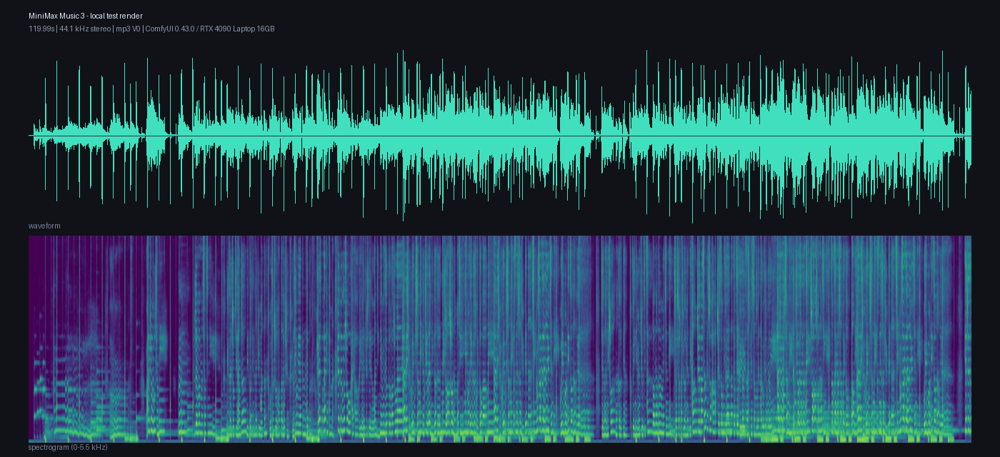

# 示例 01 ·《还没学会不想你》

中文 R&B / neo-soul 失恋抒情，72 BPM，温暖微哑男声，2 分钟。



- 曲风描述：`caption.txt`（Rhodes 电钢、暖 sub bass、刷鼓、弦乐渐入、雨声开场；副歌轻假声）
- 歌词：`歌词.txt`（`[Intro] [Verse] [Pre-Chorus] [Chorus] [Verse 2] [Bridge] [Outro]`）
- 工作流：`prompt.json`（seed 8823001，max_duration 120，30 步 euler/simple，cfg 1.7，top_k 50，mp3 V0）

## 复现

```powershell
pwsh -File .\scripts\generate.ps1 `
  -LyricsFile .\examples\01-rnb-heartbreak\歌词.txt `
  -CaptionFile .\examples\01-rnb-heartbreak\caption.txt `
  -Duration 120 -Seed 8823001 -Prefix 'Audio/rnb_heartbreak' -OutDir .\out
```

> 实测（RTX 4090 Laptop 16G）：120 秒曲约 197 秒出结果，AR 82s → DiT 102s → VAE 12s。

## 结构设计

主歌用口语化长句制造"深夜自述"的私密感，副歌把句子拆短、把韵脚压在 -i（你/迹/你/你），钩子是"还没学会 不想你"这句重复。
